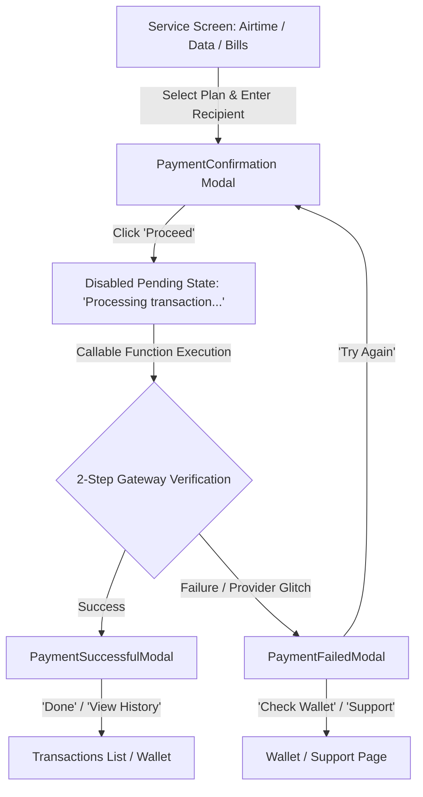

# Development Mode Improvisations & Production Security Architecture

This document provides a comprehensive guide for all developers working on the PayWaka / PayJeje codebase. It outlines the development accommodations implemented to support local testing on the Firebase Emulator suite, how they are strictly sandboxed, how production security is enforced, and how Flutterwave Payout Subaccounts (PSA) and End-of-Day batch settlements operate.

---

## 1. Core Architecture: Dev Mode vs Production Mode

To allow rapid development without manual Firestore seed scripts or requiring continuous live Firebase Auth sessions during component prototyping, specific developer fallbacks exist. **All dev fallbacks are strictly gated behind environment flags.**

| Environment | Flag Detected | Behavior |
| :--- | :--- | :--- |
| **Local Backend Emulator** | `process.env.FUNCTIONS_EMULATOR === "true"` | Enables mock test UID (`dev_user_123`) and auto-seeds test wallet balance (₦100,000) and mock PSA wallet fields (`accountReference`, `accountNumber`, `bankCode`, `bankName`, `barter_id`) if unseeded. |
| **Production Cloud Functions** | `process.env.FUNCTIONS_EMULATOR !== "true"` | **Strict Security**: Requires valid signed Firebase Auth context (`request.auth.uid`). Rejects missing user documents or zero-balance wallets with `HttpsError("unauthenticated")` or `"Insufficient balance"`. |
| **Local Frontend (Vite)** | `import.meta.env.DEV === true` | Allows fallback listeners for local UI prototyping when auth state is transitioning. |
| **Production Frontend Build** | `import.meta.env.PROD === true` | Enforces authenticated Firebase user sessions on all live Firestore and Cloud Function calls. |

---

## 2. User Wallet & Flutterwave Payout Subaccount (PSA) Architecture

In PayWaka, customer funds sit in their **individual Flutterwave Payout Subaccount** (Wema or Sterling Bank virtual NUBAN) rather than being co-mingled in the central merchant balance upon deposit.

### User Firestore Document Schema:
```javascript
{
  accountNumber: "7353739008",             // Individual Virtual NUBAN
  accountReference: "PSAF010632D562280420", // Flutterwave PSA Reference
  bankCode: "035",                          // 035 for Wema, 232 for Sterling
  bankName: "Wema Bank PLC",
  barter_id: "234000003484364",
  walletBalance: 25000                      // Available balance ledger
}
```

### Merchant Identity:
- **Merchant ID**: `process.env.FLW_MERCHANT_ID` (e.g. `"100381242"`)
- **Secret Keys**: `process.env.FLW_MSECRET_KEY` (Live) / `FLW_SECRET_KEY` (Test)

---

## 3. Real-Time Balance Authorization & End-of-Day Net Batch Settlement

To eliminate mid-day balance starvation, avoid micro-transfer fees, and prevent synchronization drift on refunds:

1. **Real-Time Daytime Purchases**:
   - Customer spends from their `walletBalance`.
   - The vendor (ClubKonnect) fulfills the bill from PayWaka's reseller pool.
   - The funds remain in the customer's Flutterwave virtual account throughout the day.
   - For every **successful** purchase, an entry is recorded in `admin_pending_settlements` with status `PENDING_SWEEP`.
2. **Instant Self-Canceling Refunds**:
   - If a bill purchase fails at the provider, the user's `walletBalance` is restored instantly.
   - The record in `admin_pending_settlements` is updated to `CANCELLED_REFUNDED` and **excluded** from the nightly sweep. No bank wires backwards are required.
3. **Nightly 23:59 Consolidated Sweep (`nightlyConsolidatedSubaccountSweep`)**:
   - Scheduled Cloud Function runs daily at 23:59 (Lagos Time).
   - Aggregates all `PENDING_SWEEP` records grouped by user `accountReference`.
   - Executes **1 single consolidated debit** from each user's `debit_subaccount` directly into the merchant pool.
   - Updates records to `SETTLED_SUCCESSFULLY`.
4. **Admin Dashboard Single-Click Trigger (`adminTriggerDailySettlement`)**:
   - Allows administrators to manually trigger the daily batch reconciliation from the Admin Dashboard at any time.

---

## 4. Collection Schemas for Admin Dashboard

### `admin_pending_settlements`
```javascript
{
  tx_ref: "PWK_usr_123_1787792613771",
  uid: "usr_123",
  userEmail: "customer@gmail.com",
  accountReference: "PSAF010632D562280420",
  accountNumber: "7353739008",
  bankCode: "035",
  bankName: "Wema Bank PLC",
  barter_id: "234000003484364",
  merchantId: "100381242",
  category: "Data", // Airtime | Data | Electricity | Cable
  amount: 2000,
  provider: "ClubKonnect",
  status: "PENDING_SWEEP", // PENDING_SWEEP | SETTLED_SUCCESSFULLY | CANCELLED_REFUNDED | SWEEP_FAILED
  dateKey: "2026-08-28",
  createdAt: Timestamp,
  settledAt: null
}
```

### `admin_daily_sweep_batches`
```javascript
{
  dateKey: "2026-08-28",
  totalSettledAmount: 145000,
  settledSubaccountsCount: 42,
  totalItems: 85,
  merchantId: "100381242",
  createdAt: Timestamp
}
```

---

## 5. UI State Transitions & Modals

### Checkout Flow:


- **[`PaymentConfirmation.jsx`](file:///c:/DEV/PayWaka/PayJeje/client/pages/PaymentConfirmation.jsx)**: Direct wallet purchase execution without Flutterwave external gateway redirection.
- **[`PaymentSuccessfulModal.jsx`](file:///c:/DEV/PayWaka/PayJeje/client/components/PaymentSuccessfulModal.jsx)**: Displays green success badge, provider details, customer recipient ID, electricity meter token/PIN copy buttons, and cashback breakdown.
- **[`PaymentFailedModal.jsx`](file:///c:/DEV/PayWaka/PayJeje/client/components/PaymentFailedModal.jsx)**: Displays red failure badge, wallet refund guarantee banner, failure diagnosis message, and one-click "Try Again" retry action.

---

## 6. Environment Variables Reference

Ensure your local `functions/.env` file contains the required provider credentials:

```env
FLW_MERCHANT_ID = "100381242"
FLW_MSECRET_KEY = "FLWSECK-..."
FLW_SECRET_KEY = "FLWSECK_TEST-..."
CLUBKONNECT_USER_ID = "CK101287514"
CLUBKONNECT_API_KEY = "6VJL723225M307FU65I6T4CNZ2D236B4G1Y3WPA81OVXNT046A2OZ341NA5M0GUJ"
```

When running `firebase emulators:start`, Firebase automatically sets `FUNCTIONS_EMULATOR="true"`, allowing developers to test without live debit fees.
